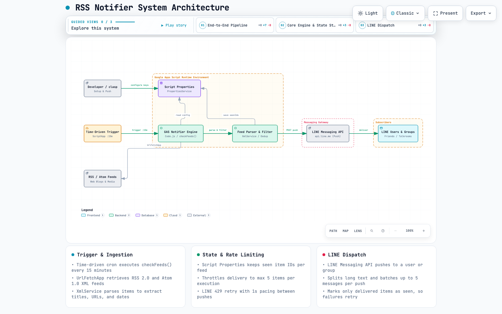

# rss-notifier

[](https://hidenobunagai.github.io/rss-notifier/)
[](https://developers.google.com/apps-script)
[](LICENSE)

A lightweight Google Apps Script (GAS) service that monitors RSS/Atom feeds and sends notifications to **LINE**.

---

## ✨ Features

- **Multi-Feed Polling**: Periodically fetches and parses RSS 2.0, RSS 1.0 (RDF) and Atom 1.0 feeds, honouring the XML declaration's encoding (e.g. Shift_JIS) when the server sends no charset.
- **Quota-Friendly LINE Notifications**: New articles from all feeds are batched, so a run usually costs a single LINE push.
- **Spam & Rate-Limit Protection**: Caps articles per feed per run (`MAX_NOTIFICATIONS_PER_RUN`), and retries 429 / 5xx / network errors with exponential backoff (or `Retry-After`). Each push carries an `X-Line-Retry-Key`, so a retry never delivers a message twice.
- **Persistent Read State**: Stores hashed IDs of the newest 200 articles per feed in `Script Properties`, so articles are never notified twice, even in long feeds.
- **Safe Feed Addition**: A newly added feed's existing articles are marked as read on its first check; only later articles are notified.
- **Visible Failures**: Feed or LINE errors make the trigger run fail, so Apps Script emails you instead of failing silently.
- **Zero Hosting Cost**: Runs completely serverless on Google Apps Script free quotas.

---

## 🏛️ System Architecture

[](https://hidenobunagai.github.io/rss-notifier/)

> 🔗 **Interactive Architecture Map (Live Preview)**: [https://hidenobunagai.github.io/rss-notifier/](https://hidenobunagai.github.io/rss-notifier/)  
> Open in your browser for light/dark theme toggles, guided walk-through chapters (Full Flow / GAS Internals / Dispatch Gateways), node inspection, and relationship tracing.

---

## 🚀 Getting Started

### 1. Push Code with clasp

Clone or download this repository, then push it to your Google Apps Script project:

```bash
bun add -g @google/clasp
clasp login
clasp push
```

### 2. Configure Script Properties

Open the Apps Script editor and run the following helper functions in order:

```javascript
// --- For LINE ---
// Register your LINE Messaging API Channel Access Token
setLineChannelAccessToken("YOUR_LINE_CHANNEL_ACCESS_TOKEN");
// Register the target User ID, Group ID, or Room ID
setLineTargetId("YOUR_LINE_TARGET_ID");

// --- Common Setup ---
// Register RSS / Atom feed URLs to monitor
setFeedUrls([
  "https://example.com/feed",
  "https://blog.example.com/rss.xml"
]);
```

Existing articles are marked as read automatically the first time each feed is
checked, so you are not flooded with old articles. `markCurrentAsRead()` resets
every feed to "all current articles read" (it also drops articles still waiting
to be sent).

> **Channel Activation Rules**:
> - **LINE**: Enabled if both `lineChannelAccessToken` and `lineTargetId` are set.

### 3. Create Time-Driven Trigger

```javascript
createTimeTrigger(); // Creates a cron trigger running checkFeeds() every 15 minutes
```

Run `validateSetup()` afterwards: it reports missing feeds, LINE settings or trigger.

---

## ⚙️ Configuration Constants (`Code.js`)

| Constant | Default | Description |
| :--- | :--- | :--- |
| `MAX_NOTIFICATIONS_PER_RUN` | `5` | Maximum articles notified per feed per execution (anti-spam); the rest follow in later runs |
| `MAX_SEEN_IDS` | `200` | Newest articles tracked per feed; older articles are ignored |
| `LINE_MAX_TEXT_LENGTH` | `5000` | Maximum character length per LINE message |
| `LINE_MAX_MESSAGES_PER_PUSH` | `5` | Maximum messages batched per LINE push call |
| `LINE_CHUNK_INTERVAL_MS` | `1000` | Delay between consecutive LINE pushes, and the base retry backoff, in ms |
| `LINE_MAX_RETRIES` | `3` | Maximum attempts per LINE push |

---

## 🛠️ Management Commands

| Function | Description |
| :--- | :--- |
| `setLineChannelAccessToken(token)` | Save LINE Channel Access Token to Script Properties |
| `setLineTargetId(id)` | Save LINE Target ID (User/Group/Room) to Script Properties |
| `setFeedUrls(urls)` | Save list of feed URLs to Script Properties |
| `markCurrentAsRead()` | Reset every feed: mark all current articles as read |
| `createTimeTrigger()` | Create 15-minute periodic trigger |
| `deleteTimeTrigger()` | Remove the periodic trigger (pause monitoring) |
| `checkFeeds()` | Manually trigger feed check and notification |
| `validateSetup()` | Verify feeds, LINE settings and the trigger; return diagnostics |

---

## 📱 LINE Messaging API Setup Guide

> **Note**: Legacy LINE Notify was discontinued in March 2025. This project uses the official **LINE Messaging API** (push messages via Official Account).

1. Create a Provider and a Messaging API Channel on [LINE Developers](https://developers.line.biz/).
2. Issue a **Channel Access Token** under "Messaging API Settings".
3. Add the Official Account as a friend (or invite it to your target Group).
4. Retrieve the target ID:
   - **User ID**: From the developer console or Webhook events.
   - **Group ID**: From group invite webhook events or console settings.
5. In Apps Script, execute `setLineChannelAccessToken(...)` and `setLineTargetId(...)`.

### LINE Quota Considerations
- In Japan, the free **Communication plan** includes 200 messages/month (reduced from 1,000 in June 2023); the paid Light plan includes 5,000. Check the current plans for your region on [LINE for Business](https://www.lycbiz.com/jp/service/line-official-account/plan/).
- Messages are counted per recipient. One run sends all new articles in one push (up to 5 text bubbles of 5,000 characters), so it usually costs one message per recipient.
- Push messages can only reach users/groups that have added the bot as a friend.

---

## 🔍 Troubleshooting

- **No notifications sent**: Run `validateSetup()` to check feeds, LINE settings and the trigger. Failed runs are listed under *Executions* in the Apps Script editor, and Apps Script emails the owner about trigger failures.
- **LINE 401 Unauthorized**: Token is invalid or expired. Re-issue and update via `setLineChannelAccessToken(...)`.
- **LINE 400 Bad Request**: Invalid target ID or bot is not a member of the group/friend list.
- **LINE 429 Too Many Requests**: Rate limit, or the monthly message quota is used up (200 on the free plan in Japan).
- **A newly added feed sends nothing**: Expected on its first check; its current articles are marked as read.

---

## 📁 Repository Structure

```
.
├── Code.js              # Main GAS application script
├── appsscript.json      # Google Apps Script manifest
├── README.md            # English documentation
├── LICENSE              # MIT license
├── docs/                # Architecture and visualization assets
│   ├── index.html       # GitHub Pages root (redirects to architecture.html)
│   ├── architecture.html# Interactive architecture diagram
│   ├── architecture.json# Archify specification schema
│   └── architecture.png # archify PNG export (Export > PNG)
├── test/                # Local test suite (`bun test`)
├── .github/workflows/   # CI: runs `bun test` on pushes and pull requests
└── .claspignore         # Limits `clasp push` to GAS files (see below)
```

### `clasp push` scope and local tests

`.claspignore` is an **allow-list**: everything is ignored first (`**/**`), then only
`appsscript.json`, `*.gs`, `*.js` and `*.html` at the repository root are re-included.
Keeping it an allow-list (rather than a deny-list of `docs/`, `test/`, …) matters, because
placing a `.claspignore` **replaces** clasp's built-in ignore rules — a deny-list would
therefore let `node_modules/**/*.js` and root-level tooling `*.js` back into the push set.

Verify what would be uploaded before pushing:

```bash
clasp status   # Tracked files: appsscript.json, Code.js
```

When you add a GAS file, add a matching `!` line to `.claspignore`; if you forget, it
shows up under "Untracked files" in `clasp status`.

Feed parsing, read-state handling, batching and LINE retries are covered by a small
harness that loads `Code.js` with stubbed GAS globals (CI runs the same command):

```bash
bun test
```
